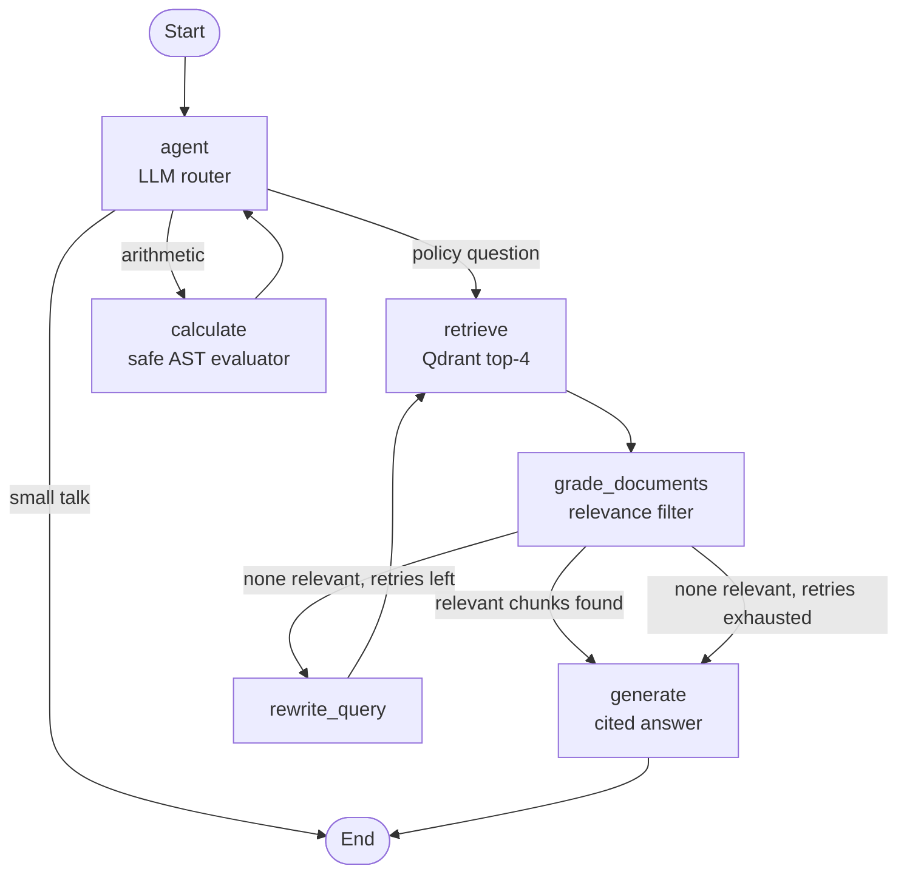

# Enterprise Agentic RAG Pipeline with Dynamic Tool Routing

An agentic Retrieval-Augmented Generation (RAG) system built as a **LangGraph state machine**. An LLM router decides whether to search a knowledge base, run a calculator, or answer directly. Retrieved chunks are graded for relevance, and if they are irrelevant the agent **rewrites the query and retries** before generating a grounded, cited answer. A Streamlit dashboard shows the graph executing in real time and scores answer quality with an evaluation suite.

**Stack:** Python 3.12 · LangGraph · Qdrant (local) · FastEmbed (Hugging Face BGE embeddings) · Groq (`openai/gpt-oss-120b`) · Streamlit · Ragas

---

## Features

- **Dynamic tool routing:** the LLM chooses between `search_knowledge_base`, a sandboxed `calculator`, or a direct answer, using function calling.
- **Self-correcting retrieval:** a grader node filters irrelevant chunks. If nothing relevant remains, a rewrite node produces a better query and retries (up to 2 times).
- **Grounded answers with citations:** answers use only the graded context, cite sources like `[1]`, and fall back to an explicit "not found" message instead of guessing.
- **Zero-cost embeddings:** `BAAI/bge-small-en-v1.5` runs locally through FastEmbed (384 dimensions), with no embedding API or key.
- **Local vector store:** embedded Qdrant persisted on disk. No Docker or server needed.
- **Live observability:** the Streamlit UI streams each graph node as it runs, with tool arguments, chunks retrieved vs. kept, rewrites, and sources.
- **Built-in evaluation:** faithfulness, answer relevancy, and context recall on a golden question set, using an LLM-as-judge (default) or Ragas.
- **Resilient LLM calls:** automatic retries, a fallback when the model emits a malformed tool call, and capped grader concurrency to respect rate limits.

## Architecture



| Node | Role |
|---|---|
| `agent` | Router. Binds the two tools to the LLM and picks one (or answers directly). |
| `retrieve` | Embeds the search query and fetches the top 4 chunks from Qdrant (cosine similarity). |
| `grade_documents` | LLM grades each chunk (structured output via function calling) and keeps only relevant ones. |
| `rewrite_query` | Rewrites a failed query using precise policy vocabulary, then loops back to `retrieve`. |
| `calculate` | Evaluates arithmetic with a restricted AST parser (no `eval`). |
| `generate` | Writes the final answer from graded context only, with inline citations. |

## Project structure

```
enterprise-agentic-rag/
├── app.py            # Streamlit dashboard: chat, live graph trace, evaluation tab
├── agent.py          # LangGraph state machine, tools, nodes, conditional edges
├── ingest.py         # Chunk, embed, and index documents into Qdrant
├── evaluator.py      # Golden-set evaluation (custom LLM judge or Ragas)
├── config.py         # Groq LLM, FastEmbed embeddings, Qdrant client factories
├── check_setup.py    # Diagnostic: checks the key, model, embeddings, and index
├── requirements.txt
├── .env.example
└── .gitignore
```

## Quick start (macOS)

**Prerequisites:** Python 3.12 (`brew install python@3.12`) and a free Groq API key from [console.groq.com/keys](https://console.groq.com/keys).

```bash
# 1. Create and activate a virtual environment
python3.12 -m venv .venv
source .venv/bin/activate

# 2. Install dependencies
pip install --upgrade pip
pip install -r requirements.txt

# 3. Configure your key
cp .env.example .env
open -e .env        # set GROQ_API_KEY=gsk_... and save

# 4. Verify the setup (the first run downloads the ~130 MB embedding model)
python check_setup.py

# 5. Index the sample documents
python ingest.py

# 6. Launch the app
streamlit run app.py
```

Open the URL Streamlit prints (usually `http://localhost:8501`).

## Configuration

Set these in `.env`:

| Variable | Default | Purpose |
|---|---|---|
| `GROQ_API_KEY` | none (required) | Your Groq API key (starts with `gsk_`) |
| `GROQ_MODEL` | `openai/gpt-oss-120b` | Chat model on Groq. It must support tool calling. |
| `EMBEDDING_MODEL` | `BAAI/bge-small-en-v1.5` | Local FastEmbed model |

Groq retires models from time to time. If you get a "model not found" error, pick a current tool-calling model from [console.groq.com/docs/models](https://console.groq.com/docs/models) and update `GROQ_MODEL`. No code changes are needed. If you change `EMBEDDING_MODEL`, delete `qdrant_data/` and re-run `ingest.py`, because vectors from different models can't be mixed.

## Usage

**Example questions** (also available as buttons in the sidebar):

| Question | Expected behaviour |
|---|---|
| How many leave days can I carry over? | Router → `search_knowledge_base` → grade → cited answer |
| What's the hotel limit in London? | Retrieval over the travel and expense policy |
| What credit do I get if uptime is 97%? | Retrieval over the cloud SLA, reasoning over the credit tiers |
| What is 24 days * 8 hours? | Router → `calculator` |
| Hello! | Direct answer, no tools |

Open **Execution trace & sources** under any answer to see every node the graph ran. If the first query retrieved nothing relevant, you will see the `rewrite_query` step.

### Add your own documents

Put `.txt` or `.md` files in a `data/` folder next to `ingest.py` (use a form-feed character to separate pages), then re-index:

```bash
python ingest.py
```

Stop the Streamlit app first. Local Qdrant allows only one process to open the store at a time.

## Evaluation

The **Evaluation** tab (or the CLI) runs the agent over a 6-question golden set and scores three metrics from 0 to 1:

| Metric | Measures |
|---|---|
| Faithfulness | Are the answer's claims supported by the retrieved context? |
| Answer relevancy | Does the answer directly address the question? |
| Context recall | Does the retrieved context contain the facts in the reference answer? |

```bash
python evaluator.py                    # custom LLM-as-judge (default, most reliable on Groq)
python evaluator.py --backend ragas    # Ragas library
```

Results are saved to `eval_results.json` and shown in the dashboard with per-question scores and the number of query rewrites. Run the CLI evaluator only when Streamlit is stopped, because both use the same Qdrant folder. Running evaluation from the dashboard avoids that conflict. Groq's free tier has per-minute token limits, so wait a minute and retry if you see a 429 error.

## Design notes

- **Routing and grading both use tool calling.** The router binds tools, and the grader uses structured output through function calling, which works reliably on Groq's hosted models.
- **Bounded self-correction.** The rewrite loop is capped at 2 retries, so a hard question can't loop forever. After the cap, the agent either answers from whatever was retrieved or says it couldn't find an answer.
- **Fail-safe grader.** If the grading model is unavailable (for example, rate-limited), the pipeline keeps the retrieved chunks instead of failing the request.
- **Safe calculator.** Arithmetic goes through an AST whitelist (numbers, `+ - * / % **`), with a cap on exponents, rather than `eval`.
- **Chunking.** Recursive character splitting (450 characters, 80 overlap) over sample HR, IT security, travel and expense, and cloud SLA documents.

## Troubleshooting

| Problem | Fix |
|---|---|
| `GROQ_API_KEY is missing` | Put a real key in `.env` (no quotes) and restart the app. |
| 404 "model not found" | The model was retired. Choose a current one and set `GROQ_MODEL`. |
| 429 rate limit | Wait a minute. Groq's free tier limits tokens per minute. |
| "Knowledge base is empty" | Run `python ingest.py`, then restart Streamlit. |
| "already accessed by another instance of Qdrant" | Stop Streamlit (Ctrl+C) before running `ingest.py` or `evaluator.py`. |
| `pip install` fails | Confirm `python --version` is 3.12. Newer versions can lack prebuilt wheels for some dependencies. |

## Limitations and next steps

- The sample knowledge base is small (4 documents), so scores on it show the pipeline works but don't predict performance on a large corpus.
- Retrieval is dense-only. Hybrid search (BM25 + vectors) and a reranker would improve recall on keyword-heavy queries.
- A proper benchmark would compare configurations (chunk size, top-k, embedding model) against a larger golden set.
- Conversation memory keeps only the last 6 messages.
